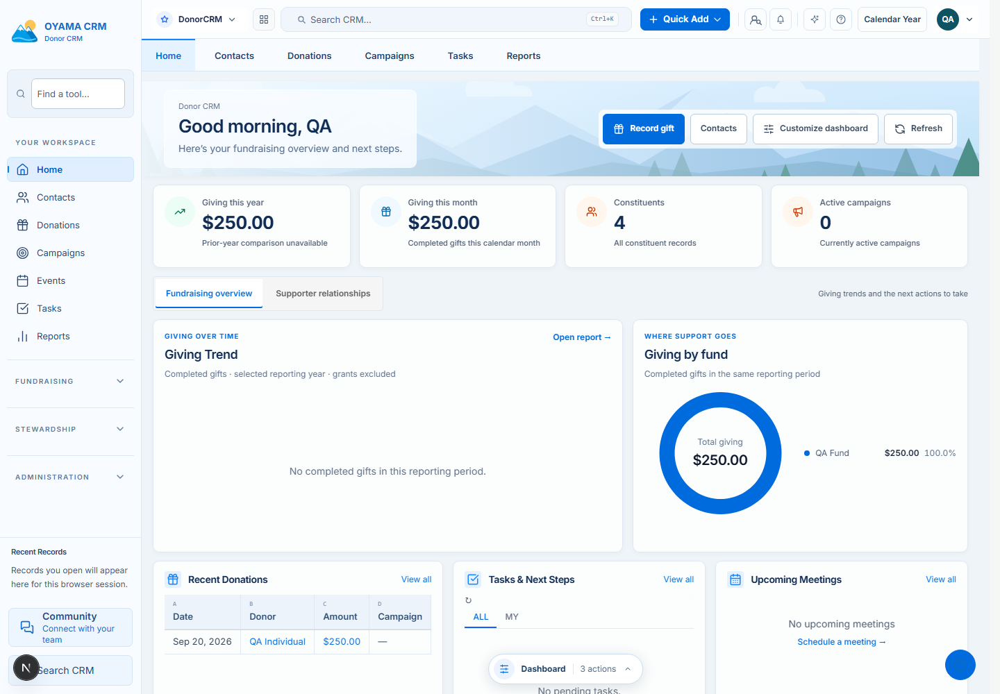
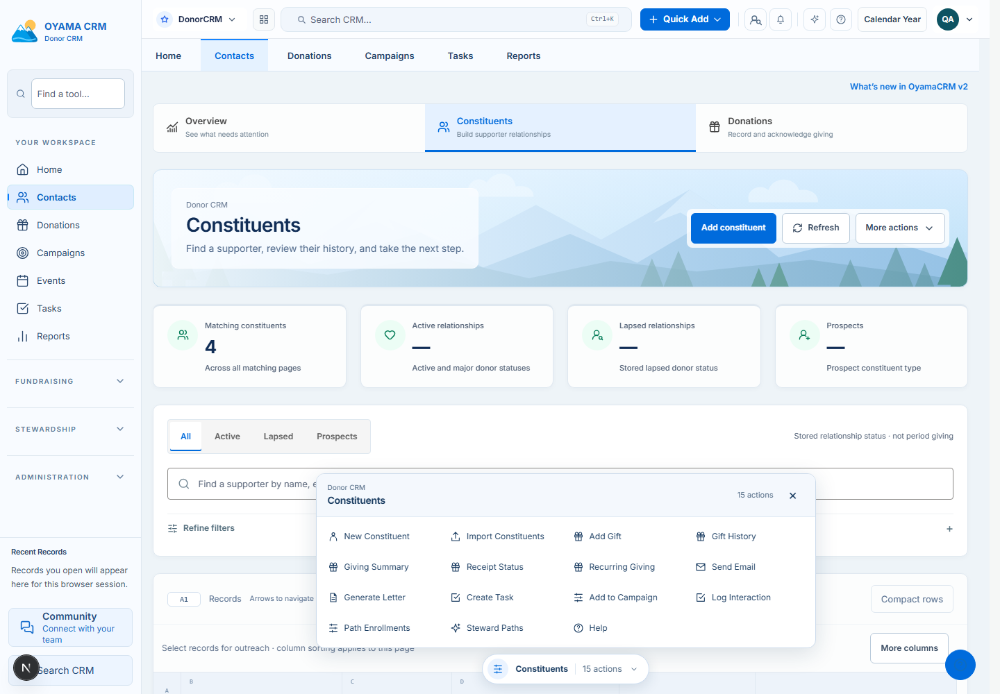
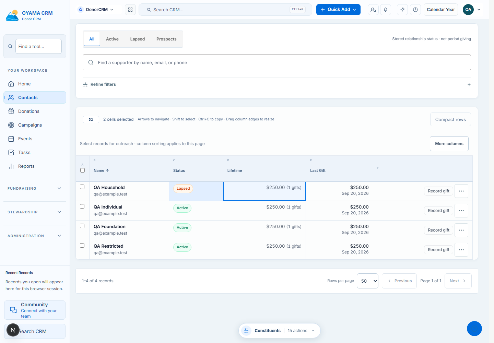
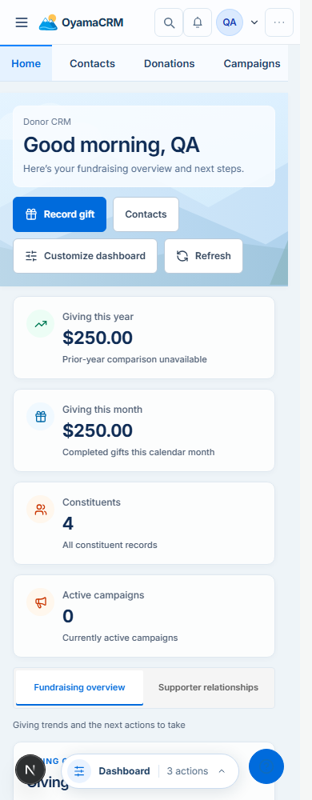
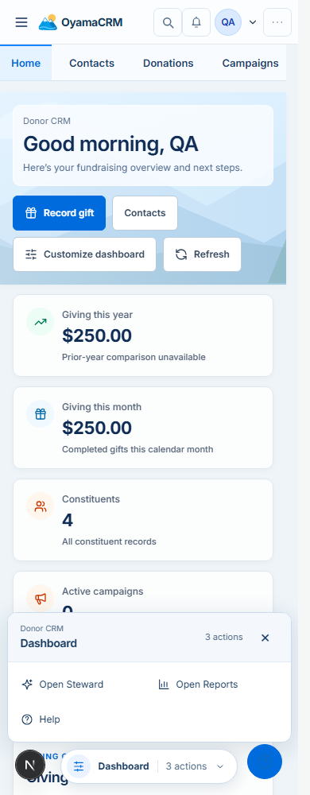

<p align="center">
  
</p>

# OyamaCRM v2

**A shared workspace for nonprofit relationships, giving, and day-to-day follow-up.**

OyamaCRM brings donor records, gifts, campaigns, events, communications, and staff work into connected workspaces. Version **2.0.0** introduces a light-blue interface, a mountain-and-sun identity, a compact contextual command dock, and spreadsheet interactions for internal data tables.



> Screenshots show the application running locally with synthetic QA records. They illustrate the interface, rather than a live organization's activity or deployment status.

## What changes in v2

- **A dashboard built around daily work.** Giving summaries, trends, fund distribution, recent gifts, tasks, meetings, new donors, and reminders, followed by optional detailed insights.
- **Commands within reach.** A bottom pill expands on mouse hover or click/tap. Available actions follow the current page and registered selection context. Escape collapses the dock.
- **Tables that behave like a spreadsheet.** Cell focus, column letters, arrow-key navigation, range selection, tab-separated copying, column resizing, and compact rows in the shared table shell.
- **Consistent application chrome.** A dedicated search field, original line icons, right-aligned account tools, and a blue mountain mark with a sunrise.
- **Clearer data states.** Failed metrics are distinguished from zeroes; fiscal dates, partial failures, refresh behavior, and optional insight availability have focused regression coverage.

### Contextual command dock



The dock replaces the workspace-status menu in the top bar. It lists working registered actions and configured links without the former eight-action limit. Feature routes retain responsibility for authorization and validation.

### Spreadsheet interactions



| Interaction | How to use it |
| --- | --- |
| Focus a cell | Click its background or tab into the table |
| Move between cells | Arrow keys; Home/End move to row edges |
| Move to table edges | Ctrl/Cmd + Home or End |
| Select a range | Shift + arrow keys or Shift + click |
| Copy selected values | Ctrl/Cmd + C; values copy as tab-separated text |
| Use a cell action | Enter or F2 focuses its first link/control |
| Resize a column | Drag the right edge of a column header |
| Change row spacing | Use Compact rows / Comfortable rows in shared table shells |
| Clear a range | Escape |

Table links, sort buttons, checkboxes, forms, and record-editing flows retain their normal controls. Copying cells does not write to CRM records. Column widths are session UI state. The floating Steward chathead and proactive suggestion popup have been removed; contextual links continue to open the dedicated Steward workspace. Mobile browse pages can retain their existing card views.

### Mobile workspace

<p>
  
  
</p>

## V2 product website

The standalone [v2 website](website/v2/index.html) is in `website/v2`, built with plain HTML, CSS and JavaScript. It includes the new identity, final app screenshots, product-preview controls and links to this GitHub repository. No build step is required.

```powershell
python -m http.server 8082 --directory website/v2
```

Open `http://localhost:8082`. See the [website guide](website/v2/README.md) for its files and verification. [Desktop and mobile website screenshots](docs/status/audit-artifacts/2026-11-01-v2-website/) are stored with the audit evidence.

## Workspaces

| Workspace | Main purpose |
| --- | --- |
| DonorCRM | Constituents, giving history, gifts, campaigns, follow-ups, and reports |
| Events | Event planning and event-specific operations |
| OyamaEmail | Email composition and communication workflows |
| OyamaLetters | Letter preparation and printable communications |
| Steward Paths | Structured stewardship workflows and enrollments |
| Watchdog / Webmaster | Security operations and website tooling where enabled |

Feature availability depends on the workspace, configuration, and permissions. Compassion CRM is reserved for future separate development.

## Run locally

Use Node.js compatible with the installed Next.js release, pnpm **10**, and MySQL. Start from the configuration documented in [.env.example](.env.example).

```powershell
pnpm install
Copy-Item .env.example .env.local
```

Configure `DATABASE_URL`, `JWT_SECRET`, and the browser/API origins for your environment. Then initialize a development database and start the services:

```powershell
pnpm db:generate
pnpm db:migrate
pnpm dev:all
```

The default web address is **http://localhost:3000** and the API is **http://localhost:4000**. `dev:all` enables permissive development CORS. Use the deployment documentation and environment-specific origins for hosted environments.

Optional synthetic development data:

```powershell
pnpm db:seed:small
```

For separate processes, use `pnpm dev:web` and `pnpm dev:api`. Build with `pnpm build` and `pnpm build:server`.

## Verify a change

```powershell
pnpm lint
pnpm typecheck
pnpm test:unit
pnpm test:api
pnpm test:e2e:workspace
pnpm test:e2e:fiscal
```

The workspace browser check runs against a local web server, intercepts API calls with QA fixtures, and saves screenshots under `docs/status/audit-artifacts/2026-11-01-v2-workspace/`. Set `QA_BASE_URL` to use another development URL. Browser binaries must be available to Playwright (`pnpm exec playwright install chromium`).

Focused checks do not establish production readiness for every module. Current evidence, outstanding work, and deployment considerations are tracked in the [production checklist](docs/status/production-readiness-checklist.md).

## Repository map

| Path | Contents |
| --- | --- |
| `app/` | Next.js routes, layouts, and client UI |
| `app/components/` | Shared UI and feature components |
| `app/features/` | Feature contracts, services, and calculations |
| `server/src/` | API routes, authorization, services, and server integration |
| `prisma/` | Database schema, migrations, and seed tools |
| `tests/` | Unit, API, smoke, and browser verification |
| `public/branding/` | Product identity assets; separate from tenant logos |
| `docs/` | Architecture, module guides, status, and screenshot evidence |

## Documentation

- [Feature status](docs/status/features.md) and [production checklist](docs/status/production-readiness-checklist.md)
- [Staff operating guide](docs/howto/HOW_TO_USE.md)
- [DonorCRM guide](docs/modules/donor-crm/README.md)
- [Email workspace](docs/DONOR_CRM_EMAIL_BUILDER.md)
- [Letters workspace](docs/DONOR_CRM_LETTERS_PRINTABLES.md)
- [Steward Paths](docs/modules/donor-crm/steward-paths.md)
- [Architecture and project plan](docs/MASTER_PLAN.md)
- [V2 screenshots and interaction evidence](docs/status/audit-artifacts/2026-11-01-v2-workspace/README.md)

## License

This is a private repository. See [LICENSE.md](LICENSE.md) for the applicable terms.
